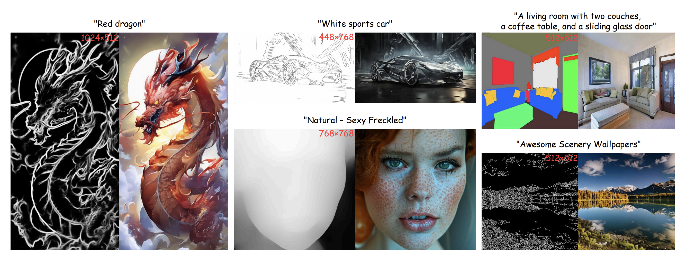
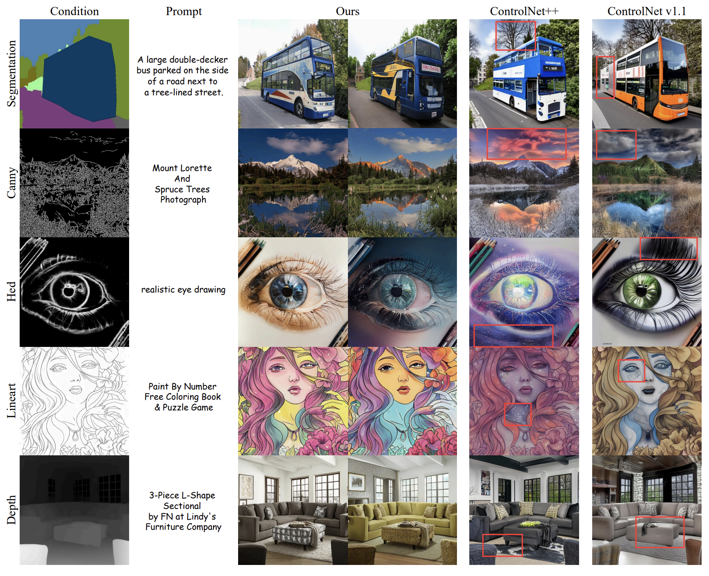

<div align ="center">

<h1> ControlAR </h1>
<h3> Controllable Image Generation with Autoregressive Models </h3>

Zongming Li<sup>1,\*</sup>, [Tianheng Cheng](https://scholar.google.com/citations?user=PH8rJHYAAAAJ&hl=zh-CN)<sup>1,\*</sup>, [Shoufa Chen](https://shoufachen.com/)<sup>2</sup>, [Peize Sun](https://peizesun.github.io/)<sup>2</sup>, Haocheng Shen<sup>3</sup>,Longjin Ran<sup>3</sup>, Xiaoxin Chen<sup>3</sup>, [Wenyu Liu](http://eic.hust.edu.cn/professor/liuwenyu)<sup>1</sup>, [Xinggang Wang](https://xwcv.github.io/)<sup>1,📧</sup>

<sup>1</sup> Huazhong University of Science and Technology,
<sup>2</sup> The University of Hong Kong
<sup>3</sup> vivo AI Lab

<b>ICLR 2025</b>

(\* equal contribution, 📧 corresponding author)

[](https://arxiv.org/abs/2410.02705)
[](https://huggingface.co/spaces/wondervictor/ControlAR)
[](https://huggingface.co/wondervictor/ControlAR)

</div>


<div align="center">

</div>


## News
`[2025-01-23]:` Our ControlAR has been accepted by ICLR 2025 🚀 !\
`[2024-12-12]:` We introduce a control strength factor, employ a larger control encoder(dinov2-base), and optimize text alignment capabilities along with generation diversity. New model weight: depth_base.safetensors and edge_base.safetensors. The edge_base.safetensors can handle three types of edges, including Canny, HED, and Lineart.\
`[2024-10-31]:` The code and models have been released!\
`[2024-10-04]:` We have released the [technical report of ControlAR](https://arxiv.org/abs/2410.02705). Code, models, and demos are coming soon!


## Highlights

* ControlAR explores an effective yet simple *conditional decoding* strategy for adding spatial controls to autoregressive models, e.g., [LlamaGen](https://github.com/FoundationVision/LlamaGen), from a sequence perspective.

* ControlAR supports *arbitrary-resolution* image generation with autoregressive models without hand-crafted special tokens or resolution-aware prompts.

## TODO

- [x] release code & models.
- [x] release demo code and HuggingFace demo: [HuggingFace Spaces 🤗](https://huggingface.co/spaces/wondervictor/ControlAR)


## Results

We provide both quantitative and qualitative comparisons with diffusion-based methods in the technical report! 

<div align="center">

</div>

<!-- 
## Models

We released checkpoints of text-to-image ControlAR on different controls and settings, *i.e.* arbitrary-resolution generation.

| AR Model | Type | Control encoder | Control | Arbitrary-Resolution | Checkpoint |
| :--------| :--: | :-------------: | :-----: | :------------------: | :--------: |
| [LlamaGen-XL](https://github.com/FoundationVision/LlamaGen#-text-conditional-image-generation) | t2i | DINOv2-small | Canny Edge | ✅ | [ckpt](https://huggingface.co/wondervictor/ControlAR/blob/main/canny_MR.safetensors) |
| [LlamaGen-XL](https://github.com/FoundationVision/LlamaGen#-text-conditional-image-generation) | t2i | DINOv2-small | Depth | ✅ | [ckpt](https://huggingface.co/wondervictor/ControlAR/blob/main/depth_MR.safetensors) |
| [LlamaGen-XL](https://github.com/FoundationVision/LlamaGen#-text-conditional-image-generation) | t2i | DINOv2-small | HED Edge | ❌ | [ckpt](https://huggingface.co/wondervictor/ControlAR/blob/main/hed.safetensors) |
| [LlamaGen-XL](https://github.com/FoundationVision/LlamaGen#-text-conditional-image-generation) | t2i | DINOv2-small | Seg. Mask | ❌ | [ckpt](https://huggingface.co/wondervictor/ControlAR/blob/main/seg_cocostuff.safetensors) |
| [LlamaGen-XL](https://github.com/FoundationVision/LlamaGen#-text-conditional-image-generation) | t2i | DINOv2-base | Edge (Canny, Hed, Lineart) | ❌ | [ckpt](https://huggingface.co/wondervictor/ControlAR/blob/main/edge_base.safetensors) |
| [LlamaGen-XL](https://github.com/FoundationVision/LlamaGen#-text-conditional-image-generation) | t2i | DINOv2-base | Depth | ❌ | [ckpt](https://huggingface.co/wondervictor/ControlAR/blob/main/depth_base.safetensors) | -->


## Getting Started

<!-- ### Installation

```bash
conda create -n ControlAR python=3.10
git clone https://github.com/hustvl/ControlAR.git
cd ControlAR
pip install torch==2.1.2+cu118 --extra-index-url https://download.pytorch.org/whl/cu118
pip install -r requirements.txt
pip3 install -U openmim 
mim install mmengine 
mim install "mmcv==2.1.0"
pip3 install "mmsegmentation>=1.0.0"
pip3 install mmdet
git clone https://github.com/open-mmlab/mmsegmentation.git
``` -->
<!-- 
### Pretrained Checkpoints for ControlAR

|tokenizer| text encoder |LlamaGen-B|LlamaGen-L|LlamaGen-XL|
|:-------:|:------------:|:--------:|:--------:|:---------:|
|[vq_ds16_t2i.pt](https://huggingface.co/peizesun/llamagen_t2i/resolve/main/vq_ds16_t2i.pt)|[flan-t5-xl](https://huggingface.co/google/flan-t5-xl)|[c2i_B_256.pt](https://huggingface.co/FoundationVision/LlamaGen/resolve/main/c2i_B_256.pt)|[c2i_L_256.pt](https://huggingface.co/FoundationVision/LlamaGen/resolve/main/c2i_L_256.pt)|[t2i_XL_512.pt](https://huggingface.co/peizesun/llamagen_t2i/resolve/main/t2i_XL_stage2_512.pt)|

We recommend storing them in the following structures:
```
|---checkpoints
      |---t2i
            |---canny/canny_MR.safetensors
            |---hed/hed.safetensors
            |---depth/depth_MR.safetensors
            |---seg/seg_cocostuff.safetensors
            |---edge_base.safetensors
            |---depth_base.safetensors
      |---t5-ckpt
            |---flan-t5-xl
                  |---config.json
                  |---pytorch_model-00001-of-00002.bin
                  |---pytorch_model-00002-of-00002.bin
                  |---pytorch_model.bin.index.json
                  |---tokenizer.json
      |---vq
            |---vq_ds16_c2i.pt
            |---vq_ds16_t2i.pt
      |---llamagen (Only necessary for training)
            |---c2i_B_256.pt
            |---c2i_L_256.pt
            |---t2i_XL_stage2_512.pt
```

### Demo

Coming soon... -->

### 1. Generative model is LlamaGen，control encoder is dinov2-small:


#### Train：
```bash
bash scripts/autoregressive/train_qwenvl_gpt_edit.sh 
```
make sure: --adapter-size small

#### Inference：
```bash
python autoregressive/sample/sample_t2i_qwenvl.py --gpt-ckpt model_weight/ControlAR/output/weights/Edit/LlamaGen_small_40000.pt --condition-path ControlAR/evaluations/PIE-Bench/annotation_images/3_delete_object_80/2_natural/2_human/322000000005.jpg --prompt "Remove the bottles of water" --use-adapter True  --cfg-scale 9 --qwenvl-image-size 512 --adapter-size small --adapter-name dinov2 --image-size 512 --temperature 0.8 --use-fusion True --seed 0
```

#### Test：
```bash
bash scripts/autoregressive/test_t2i_qwenvl.sh --gpt-ckpt model_weight/ControlAR/output/weights/Edit/LlamaGen_small_40000.pt --use-adapter True --use-fusion True --cfg-scale 9 --temperature 0.8
```


### 2. Generative model is LlamaGen，control encoder is dinov2-base:


#### Train：
```bash
bash scripts/autoregressive/train_qwenvl_gpt_edit.sh 
```
make sure: --adapter-size base

#### Inference：
```bash
python autoregressive/sample/sample_t2i_qwenvl.py --gpt-ckpt model_weight/ControlAR/output/weights/Edit/LlamaGen_base_40000.pt --condition-path ControlAR/evaluations/PIE-Bench/annotation_images/3_delete_object_80/2_natural/2_human/322000000005.jpg --prompt "Remove the bottles of water" --use-adapter True  --cfg-scale 5 --qwenvl-image-size 512 --adapter-size base --adapter-name dinov2 --image-size 512 --temperature 0.8 --use-fusion True --seed 0
```

#### Test：
```bash
bash scripts/autoregressive/test_t2i_qwenvl.sh --gpt-ckpt model_weight/ControlAR/output/weights/Edit/LlamaGen_base_40000.pt --use-adapter True --use-fusion True --cfg-scale 5 --temperature 0.8
```


### 3. Generative model is Janus-Pro，control encoder is dinov2-small:


#### Train：
```bash
bash scripts/autoregressive/train_qwenvl_janus_edit.sh 
```

#### Inference：
```bash
python autoregressive/sample/sample_t2i_Janus_edit.py --gpt-ckpt model_weight/ControlAR/output/weights/Edit/Janus_small_50000.pt --condition-path ControlAR/evaluations/PIE-Bench/annotation_images/3_delete_object_80/2_natural/2_human/322000000005.jpg --prompt "Remove the bottles of water" --use-adapter True  --cfg-scale 3 --qwenvl-image-size 512 --adapter-size small --adapter-name dinov2 --image-size 512 --temperature 0.7 --use-fusion True --seed 0
```

#### Test：
```bash
bash scripts/autoregressive/test_t2i_Janus_edit.sh --gpt-ckpt model_weight/ControlAR/output/weights/Edit/Janus_small_50000.pt --use-adapter True --use-fusion True --cfg-scale 3 --temperature 0.7
```


### 4. Generative model is Janus-Pro，control encoder is dinov2-base:

#### Train：
```bash
bash scripts/autoregressive/train_qwenvl_janus_edit.sh 
```

#### Inference：
```bash
python autoregressive/sample/sample_t2i_Janus_edit.py --gpt-ckpt /model_weight/ControlAR/output/weights/Edit/Janus_base_90000.pt --condition-path ControlAR/evaluations/PIE-Bench/annotation_images/3_delete_object_80/2_natural/2_human/322000000005.jpg --prompt "Remove the bottles of water" --use-adapter True  --cfg-scale 3 --qwenvl-image-size 512 --adapter-size base --adapter-name dinov2 --image-size 512 --temperature 0.7 --use-fusion True --seed 0
```

#### 测评：
```bash
bash scripts/autoregressive/test_t2i_Janus_edit.sh --gpt-ckpt model_weight/ControlAR/output/weights/Edit/Janus_base_90000.pt --use-adapter True --use-fusion True --cfg-scale 3 --temperature 0.7 --adapter-size base
```


## Acknowledgments

The development of ControlAR is based on [LlamaGen](https://github.com/FoundationVision/LlamaGen), [ControlNet](https://github.com/lllyasviel/ControlNet), [ControlNet++](https://github.com/liming-ai/ControlNet_Plus_Plus), and [AiM](https://github.com/hp-l33/AiM), and we sincerely thank the contributors for thoese great works!

## Citation
If you find ControlAR is useful in your research or applications, please consider giving us a star 🌟 and citing it by the following BibTeX entry.

```bibtex
@inproceedings{ControlAR,
      title={ControlAR: Controllable Image Generation with Autoregressive Models}, 
      author={Li, Zongming and Cheng, Tianheng and Chen, Shoufa and Sun, Peize and Shen, Haocheng and Ran, Longjin and Chen, Xiaoxin and Liu, Wenyu and Wang, Xinggang},
      booktitle={International Conference on Learning Representations},
      year={2025}
}
```

